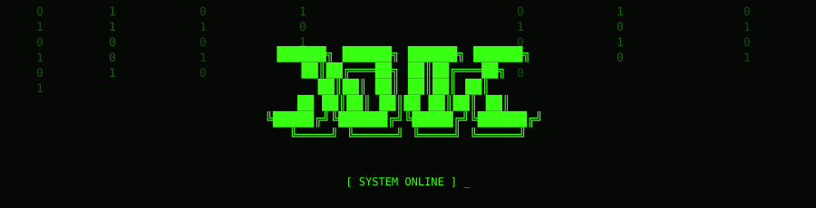

<div align="center">




```text
      ╔══════════════════════════════════════════════════════╗
      ║                                                      ║
      ║              ██╗  ██████╗       ██╗  ██████╗         ║
      ║              ██║ ██╔═══██╗      ██║ ██╔═══██╗        ║
      ║              ██║ ██║   ██║      ██║ ██║   ██║        ║
      ║        ██║   ██║ ██║   ██║ ██   ██║ ██║   ██║        ║
      ║        ╚██████╔╝ ╚██████╔╝ ╚█████╔╝ ╚██████╔╝        ║
      ║         ╚═════╝   ╚═════╝   ╚════╝   ╚═════╝         ║
      ║                                                      ║
      ║             [ SYSTEM BOOTED SUCCESSFULLY ]           ║
      ║                                                      ║
      ╚══════════════════════════════════════════════════════╝
```


<br/>


</div>

---

## `01 // USER PROFILE`

```text
╔══════════════════════════════════════════════╗
║                 USER DATA                    ║
╠══════════════════════════════════════════════╣
║  USERNAME : JOJO-73914                       ║
║  CLASS    : SOFTWARE DEVELOPER               ║
║  STATUS   : LEARNING / BUILDING              ║
║  LOCATION : DIGITAL WORLD                    ║
║  QUEST    : MASTER THE ART OF CODE           ║
╚══════════════════════════════════════════════╝
```

### Hey, I'm Jojo.

Sou entusiasta de tecnologia e desenvolvimento de software, interessado em explorar diferentes áreas da programação e transformar ideias em projetos reais.

Atualmente, estou desenvolvendo meus conhecimentos em:

- Software Development
- Web Development
- Database Design
- Object-Oriented Programming
- Game Development

Acredito que programar é uma mistura de lógica, criatividade e curiosidade. Gosto de experimentar tecnologias, entender como as coisas funcionam e construir soluções.

```text
> CURRENT OBJECTIVE:
> Learn something new.
> Build something interesting.
> Repeat.
```

---

## `02 // TECH INVENTORY`

```text
[ SCANNING SYSTEM... ]
[ TECHNOLOGIES DETECTED: ]
```

### Languages

<div align="left">


</div>

### Frameworks & Development

<div align="left">


</div>

### Databases & Tools

<div align="left">


<br/><br/>


</div>

```text
┌──────────────────────────────────────────────┐
│              SKILL DEVELOPMENT               │
├──────────────────────────────────────────────┤
│  SOFTWARE ENGINEERING    [ LEARNING ]        │
│  WEB DEVELOPMENT         [ LEARNING ]        │
│  DATABASES               [ LEARNING ]        │
│  GAME DEVELOPMENT        [ EXPLORING ]       │
│  PROGRAMMING             [ LEVELING UP ]     │
└──────────────────────────────────────────────┘
```

---

## `03 // PLAYER STATUS`

```text
       .--------------------------------.
       |         PLAYER STATUS          |
       |--------------------------------|
       |                                |
       |  CLASS  : DEVELOPER            |
       |  LEVEL  : IN PROGRESS          |
       |  EXP    : + KNOWLEDGE          |
       |  HP     : 100/100              |
       |  MP     : 100/100              |
       |                                |
       |  CURRENT QUESTS:               |
       |  [x] Learn programming         |
       |  [x] Build projects            |
       |  [ ] Master GameDev            |
       |  [ ] Explore new technologies  |
       |                                |
       '--------------------------------'
```

### Interests

| Category | Status |
|---|---|
| Software Development | `ACTIVE` |
| Web Development | `ACTIVE` |
| Database Architecture | `ACTIVE` |
| Game Development | `EXPLORING` |
| Technology | `INFINITE` |

---

## `04 // PROJECT DATABASE`

```text
> ACCESSING PROJECT ARCHIVE...
> FOUND: PROJECTS
```

<table>
<tr>
<td width="50%" valign="top">

### [01] FREE HAND

**Libras Recognition System**

Projeto experimental de reconhecimento de sinais em Libras através da webcam, explorando visão computacional e desenvolvimento web.

`JAVASCRIPT` `MEDIAPIPE`

<a href="https://github.com/Jojo-73914?tab=repositories">[ ACCESS PROJECTS ]</a>

</td>
<td width="50%" valign="top">

### [02] UNKNOWN PROJECT

**Future Development**

Novas ideias, experimentos e projetos serão adicionados conforme meu inventário evoluir.

`COMING SOON`

<a href="https://github.com/Jojo-73914?tab=repositories">[ ACCESS ARCHIVE ]</a>

</td>
</tr>
</table>

---

## `05 // GITHUB STATISTICS`

<div align="center">


<br/>


<br/>


</div>

---

## `06 // THE LAST BONFIRE`

```text
             .     (  .
          .       )   (
            .   (     )
               )   )  (
             .   (     )
                 )   (
               .  ) (
                  ||
                  ||
             _____||_____
            /            \
           /______________\

          THE FLAME STILL BURNS.
```

<div align="center">


<br/>

*Rest here, weary developer.*

*Even the longest journey needs a checkpoint.*

**Praise the Sun.**

</div>

---

## `07 // CONNECTION TERMINAL`

<div align="center">

<a href="https://github.com/Jojo-73914">

</a>

<a href="https://github.com/Jojo-73914?tab=repositories">

</a>

</div>

```text
╔══════════════════════════════════════════════╗
║                                              ║
║  CONNECTION TERMINATED.                      ║
║  THANK YOU FOR VISITING MY PROFILE.          ║
║                                              ║
║  > KEEP CODING.                              ║
║  > KEEP EXPLORING.                           ║
║  > DON'T GO HOLLOW.                          ║
║                                              ║
╚══════════════════════════════════════════════╝
```

<div align="center">


</div>
